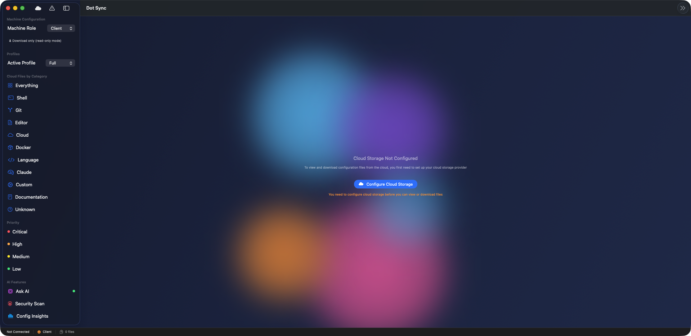
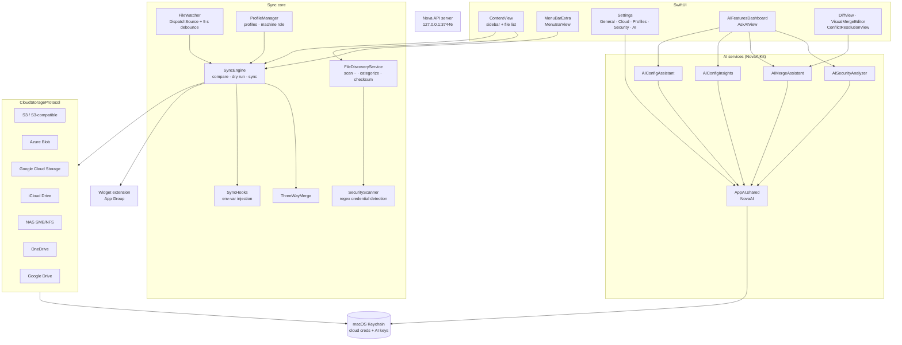
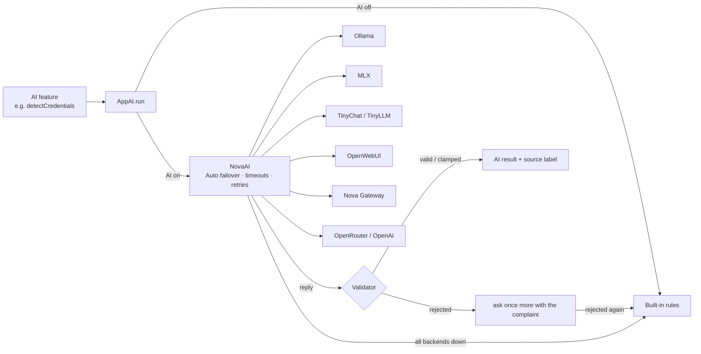

# Dot Sync


**Smart dotfile synchronization across Macs through cloud storage: config discovery, credential scanning before upload,
three-way merge, real-time file watching, a WidgetKit widget, and optional AI assistance (NovaAIKit) that always falls
back to built-in rules.**



---

## Table of Contents

- [Overview](#overview)
- [Architecture](#architecture)
- [Features](#features)
- [AI](#ai)
- [Installation](#installation)
- [Building from Source](#building-from-source)
- [Configuration](#configuration)
- [Cloud Provider Setup](#cloud-provider-setup)
- [Sync Profiles and Machine Roles](#sync-profiles-and-machine-roles)
- [Security](#security)
- [Widget Extension](#widget-extension)
- [Nova API Integration](#nova-api-integration)
- [Testing](#testing)
- [Troubleshooting](#troubleshooting)
- [Version History](#version-history)
- [License](#license)

---

## Overview

Dot Sync is a native macOS app that keeps developer configuration files (dotfiles) in sync across machines through a
cloud or NAS backend. It targets what iCloud ignores: shell profiles, git settings, editor configs, cloud CLI configs
and tool preferences.

It discovers config files automatically, refuses to upload anything that looks like a credential, syncs in both
directions with conflict detection and three-way merge, and can watch files and sync on change. An optional AI layer
(local Ollama/MLX first, cloud only if you add a key) explains changes, suggests merges, audits configs and answers
questions; with AI off, every one of those features still works from built-in rules.

**Who this is for:** developers and DevOps/SRE engineers who keep several Macs configured the same way.

---

## Architecture



### Project structure

```
Dot Sync/
  DotSyncApp.swift          App, menu bar extra, Settings scene, Nova API start
  AI/AppAI.swift            The one NovaAI instance, legacy migration, AppAI.run helper
  Models/                   ConfigFile, SyncProfile, SyncOperation, SyncHooks, MachineInfo, CloudProvider, ...
  Services/                 SyncEngine, FileDiscoveryService, SecurityScanner, ThreeWayMerge, FileWatcher,
                            cloud providers (S3, Azure, GCP, iCloud, NAS, OneDrive, Google Drive)
  Services/AI/              AISecurityAnalyzer, AIMergeAssistant, AIConfigInsights, AIConfigAssistant
  Views/                    ContentView, PreferencesView, AskAIView, AIFeaturesDashboard, DiffView, ...
  NovaAPIServer.swift       Loopback status API
Dot Sync Widget/            WidgetKit extension
Shared/                     WidgetData, SharedDataManager (App Group)
Dot Sync Tests/             XCTest suite (220 tests)
```

---

## Features

### Config File Discovery

Dot Sync scans the home directory for known configuration file patterns and organizes them by category:

| Category      | Files                                                        | Priority |
|---------------|--------------------------------------------------------------|----------|
| Shell         | .zshrc, .bashrc, .bash_profile, .profile, .p10k.zsh, .fzf.* | Critical |
| Git           | .gitconfig, .gitignore_global                                | Critical |
| Editor        | .vimrc, .vim/, VS Code settings, Neovim config               | High     |
| Cloud         | .aws/config, .azure/config, .config/gcloud/                  | High     |
| Terminal      | Terminal.app plist, iTerm2 plist                              | High     |
| Docker        | .docker/config.json (auth stripped), .dockerignore            | Medium   |
| Language      | .npmrc, .gemrc, .pypirc, .cargo/config                       | Medium   |
| Claude        | .claude/CLAUDE.md, .claude/settings.json                     | Medium   |
| Documentation | Cheatsheets (.aws_cheatsheet.md, etc.)                       | Low      |

### Cloud Storage Providers

Eight storage backends, all conforming to the `CloudStorageProtocol` interface:

| Provider         | Authentication               | Notes                          |
|------------------|------------------------------|--------------------------------|
| AWS S3           | Access Key + Secret Key      | Full S3 API                    |
| Azure Blob       | Tenant + Client ID + Secret  | Azure Storage REST API         |
| Google Cloud     | Project ID + Service Account | GCS JSON API                   |
| iCloud Drive     | System authentication        | No credentials needed          |
| NAS (SMB/NFS)    | Username + Password + Path   | Local network storage          |
| OneDrive         | Client ID + Secret + Token   | Microsoft Graph API            |
| Google Drive     | Client ID + Secret + Token   | Google Drive API               |
| S3-Compatible    | Access Key + Secret Key      | MinIO, Wasabi, Backblaze, etc. |

All credentials are stored in the macOS Keychain. Never in UserDefaults, plists, or files.

### Real-Time File Watching

The `FileWatcher` service uses `DispatchSource.makeFileSystemObjectSource` to monitor individual files via file descriptors. This replaced an earlier FSEvents implementation that caused crashes.

How it works:

1. Each watched file gets an `O_EVTONLY` file descriptor
2. A `DispatchSourceFileSystemObject` monitors `.write` and `.attrib` events
3. Changes trigger a 5-second debounce timer to batch rapid edits
4. After debounce, the file is auto-synced (if enabled) or a notification is shown
5. Cancel handlers close file descriptors on cleanup

### Three-Way Merge

When both local and remote copies have changed, Dot Sync performs a line-by-line three-way merge using the last-known common ancestor. Changes that do not overlap are merged automatically. True conflicts produce standard conflict markers (`<<<<<<< LOCAL` / `=======` / `>>>>>>> REMOTE`) for manual resolution.

### Sync Hooks

Pre-sync and post-sync shell hooks run before and after file synchronization. File metadata (name, path, category) is passed via environment variables (`$SYNC_FILENAME`, `$SYNC_FILEPATH`, `$SYNC_CATEGORY`) rather than string interpolation, preventing command injection through crafted filenames.

Default hooks:
- **Pre-sync:** `zsh -n ~/.zshrc` (syntax validation before upload)
- **Post-sync:** `git config --list > /dev/null` (verify git config after download)

### Sync Profiles

Four built-in profiles control which file categories get synced:

| Profile  | Categories Included                          |
|----------|----------------------------------------------|
| Full     | All detected config files                    |
| Minimal  | Shell + Git only                             |
| Work     | Shell, Git, Cloud, Claude, Docker            |
| Home     | Shell, Git, Editor, Claude                   |

Custom profiles can be created with arbitrary category and file selections.

### Machine Roles

Each machine is assigned a role that controls sync direction:

- **Master** -- Can upload and download. The authoritative source of config files.
- **Client** -- Download only. Receives configs from the master but does not push changes.

Machines are identified by their hardware UUID (via `IOPlatformExpertDevice`), providing stable identity across reboots.

### AI-Assisted Features

| Feature | What AI adds | Built-in result when AI is off or unreachable |
|---|---|---|
| Credential detection (`AISecurityAnalyzer`) | Finds obfuscated / base64 / connection-string secrets | Regex scan (AWS, Stripe, GitHub, Slack, JWT, bearer, private keys, passwords) |
| Config security audit | Weak settings, permissions, deprecated options | Same regex scan per file |
| Change anomaly detection | Flags suspicious modifications | Flags >30 % line-count change |
| Merge suggestion (`AIMergeAssistant`) | Keep local / keep remote / merged file with confidence | "Manual review" with line counts |
| Semantic merge | Structure-aware merge of shell, git, YAML, INI | Line-based `ThreeWayMerge` |
| Change explanation | Plain-English summary + impact | Added/removed line counts + impact level |
| Health check (`AIConfigInsights`) | Syntax/deprecation issues + score | Trailing whitespace / long-line checks + score |
| Best practices | File-specific recommendations | Static recommendations (git signing, lazy completions) |
| Shell optimization | Slow startup, conflicts, inefficiencies | nvm / rbenv / duplicate-alias detection |
| Natural-language search (`AIConfigAssistant`) | Semantic matches | Keyword search |
| Sync priorities | Upgrades priorities by importance | Usage-learned priorities |
| Config generation, migration plans | Generated content / step plan | Unavailable (returns nothing; UI says AI is needed) |
| Ask AI chat | Answers from your configs | Keyword search results, or a message saying AI is off/unreachable |

Every AI result is validated before use (see [AI](#ai)) and labeled with its source ("AI · Ollama (model)" or
"Built-in").

### Menu Bar Integration

Dot Sync lives in the macOS menu bar with a status icon that reflects current state:

- Checkmark (green) -- All files synced
- Arrows (yellow) -- Files need sync
- Warning triangle (red) -- Conflicts detected
- Rotating arrows (blue) -- Sync in progress
- Cloud (gray) -- Not yet synced

---

## AI

Dot Sync uses [NovaAIKit](https://github.com/kochj23/NovaAIKit) 1.0.0, the shared AI layer for Jordan's macOS apps. The
app has no AI client code of its own.



- **On/off:** Settings > AI > "Use AI". Off means nothing leaves the Mac and every feature uses its built-in rules.
- **Backends:** Auto (Ollama → MLX → TinyChat → TinyLLM → OpenWebUI → Nova Gateway → OpenRouter → OpenAI), or pick one.
  Model picker and editable URLs per backend; "Test connection" in Settings.
- **Keys:** OpenRouter / OpenAI / OpenWebUI keys are stored only in the macOS Keychain under
  `com.jkoch.dotsync.<backend>` (account `apiKey`), are shown as "stored", never as text, and are only sent over https.
- **Status indicator:** a dot + backend/model label in the AI dashboard, the Ask AI header and the sidebar; click it to
  re-check.
- **Failover:** Auto mode tries each reachable backend with timeouts and retries (transient 5xx / timeouts).
- **Validation:** every reply must follow the feature's format (`FINDING|…`, `RECOMMENDATION:`, `SCORE:`, …). Values are
  clamped (confidence 0–1, score 0–100, severities/impact to known levels, line numbers to the file, priorities only for
  files that were asked about). A reply that fails is retried once, then the built-in result is used.
- **Upgrade from 1.2:** the old settings (backend, Ollama model, on/off) are imported once; an OpenAI key from the old
  `com.jordankoch.DotSync` Keychain service or from UserDefaults moves to `com.jkoch.dotsync.openai`, and old
  Google/Azure/AWS/IBM AI secrets are deleted. The Google Cloud / Azure / AWS / IBM Watson AI backends were removed.
  (This is about AI backends only; Azure Blob, GCS, S3 and Google Drive remain fully supported as *storage*.)

---

## Installation

**Dot Sync is distributed as a DMG. It is not on the Mac App Store.**

1. Download `DotSync-v1.3.0-build7.dmg` from [Releases](https://github.com/kochj23/DotSync/releases) (or the local
   binaries share).
2. Open it and drag **Dot Sync** onto **Applications**.
3. Launch from Applications or Spotlight. The build is ad hoc signed for local use: the first time, right-click >
   Open.

### Requirements

- macOS 13.0 (Ventura) or later
- Optional, for AI: a local [Ollama](https://ollama.com) (or MLX / TinyChat / TinyLLM / OpenWebUI / Nova Gateway), or an
  OpenRouter / OpenAI key
- A storage backend (S3, Azure, GCS, iCloud Drive, NAS, OneDrive or Google Drive)

---

## Building from Source

```bash
git clone git@github.com:kochj23/DotSync.git
cd DotSync
open "Dot Sync.xcodeproj"     # Xcode resolves NovaAIKit (Swift Package) automatically

# Command line (Release, unsigned, then ad hoc sign):
xcodebuild -project "Dot Sync.xcodeproj" -scheme "Dot Sync" -configuration Release \
  -derivedDataPath build CODE_SIGNING_ALLOWED=NO build
codesign --force --deep -s - "build/Build/Products/Release/Dot Sync.app"
```

Dependencies: [NovaAIKit](https://github.com/kochj23/NovaAIKit) (Swift Package, `from: 1.0.0`). Everything else is
system frameworks (SwiftUI, Foundation, CryptoKit, Combine, Network, WidgetKit, SystemConfiguration, Security).

Version: `MARKETING_VERSION` / `CURRENT_PROJECT_VERSION` in the project (both Info.plists read them).

---

## Configuration

### First Launch

1. Launch Dot Sync
2. The app automatically scans your home directory for config files
3. Review discovered files in the sidebar (organized by category and priority)
4. Click "Cloud Setup" to configure your storage provider

### Sync Workflow

**Manual sync:**
1. Select files to sync (checkboxes in the file list)
2. Click "Scan" to compare local vs remote timestamps and checksums
3. Review sync status for each file:
   - Green (Synced) -- Files match
   - Blue (Local Newer) -- Your copy is newer, will upload
   - Orange (Remote Newer) -- Cloud copy is newer, will download
   - Red (Conflict) -- Both changed, needs resolution
   - Purple (Not on Remote) -- New file, will upload
4. Click "Sync Selected" to execute
5. Use Cmd+Shift+S for quick sync of all safe files

**Auto-sync:**
1. Enable Auto-Sync in Preferences
2. Dot Sync monitors selected files via DispatchSource
3. Changes trigger automatic upload after a 5-second debounce
4. Disable auto-sync at any time to return to manual control

---

## Cloud Provider Setup

### AWS S3

```bash
# Create an S3 bucket
aws s3 mb s3://my-dotfiles --region us-east-1

# Enable versioning (recommended)
aws s3api put-bucket-versioning \
  --bucket my-dotfiles \
  --versioning-configuration Status=Enabled

# Enable server-side encryption
aws s3api put-bucket-encryption \
  --bucket my-dotfiles \
  --server-side-encryption-configuration \
    '{"Rules":[{"ApplyServerSideEncryptionByDefault":{"SSEAlgorithm":"AES256"}}]}'
```

In Dot Sync: select "AWS S3", enter the bucket name, region, access key ID, and secret access key. Credentials are stored in the macOS Keychain.

### Azure Blob Storage

```bash
# Create storage account
az storage account create \
  --name mydotfiles \
  --resource-group my-rg \
  --location eastus \
  --sku Standard_LRS

# Create container
az storage container create \
  --name dotfiles \
  --account-name mydotfiles
```

In Dot Sync: select "Azure Blob", enter the storage account name, container name, tenant ID, client ID, and client secret.

### Google Cloud Storage

```bash
# Create bucket
gsutil mb -p my-project gs://my-dotfiles

# Enable versioning
gsutil versioning set on gs://my-dotfiles
```

In Dot Sync: select "Google Cloud Storage", enter the bucket name, project ID, and upload your service account key JSON.

### iCloud Drive

Select "iCloud Drive" and choose a folder location. No credentials are needed -- the app uses macOS system authentication.

### NAS (SMB/NFS)

Select "NAS (SMB/NFS)" and enter the server address, share path, username, and password. The NAS must be reachable on the local network.

### OneDrive / Google Drive

Select the provider and enter the OAuth client ID, client secret, and refresh token. Token refresh is handled automatically.

---

## Sync Profiles and Machine Roles

### Profiles

Switch between profiles in the sidebar or Preferences to control which categories of files participate in sync operations. Create custom profiles by selecting specific categories and individual files.

### Master / Client Topology

On your primary machine, set the role to **Master**. All other machines should be **Client**. This prevents accidental overwrites -- clients pull configs from the master but never push changes back.

The role is stored locally per machine and can be changed at any time in Preferences.

---

## Security

### What Never Gets Synced

These files and patterns are excluded automatically:

- SSH private keys (id_rsa, id_dsa, id_ecdsa, id_ed25519)
- Credential files (.aws/credentials, .npmrc with auth tokens)
- Command history (.bash_history, .zsh_history, .lesshst, .viminfo)
- Cache directories
- Binary files
- Swap and temp files (.swp, .tmp, .temp)
- Any file matching credential regex patterns

### Credential Detection

The `SecurityScanner` checks every file against regex patterns before allowing sync:

- Stripe API keys (sk_live_, sk_test_, pk_live_)
- AWS access keys (AKIA...)
- Bearer tokens
- JWT tokens (eyJ...)
- Hardcoded passwords
- SSH private key headers
- OAuth client secrets
- GCP service account JSON markers

Files flagged by the scanner are marked `isSafeToSync = false` and will not upload.

### Sanitization

When safe files contain isolated credential fragments (like a git credential helper line), the scanner can sanitize the content before upload:

- Removes credential helper sections from .gitconfig
- Strips auth tokens from Docker config
- Removes AWS access key lines from config files

### Data Storage

- **Credentials:** macOS Keychain (via Security framework). Never UserDefaults.
- **Cloud data:** Optional AES-256 encryption at rest
- **Backups:** .backup file created before any overwrite
- **Audit log:** All operations logged with timestamps
- **No telemetry:** nothing is sent anywhere except your chosen storage backend and, only if AI is on, your chosen AI backend (local by default)

### Command Injection Prevention

Sync hooks pass file metadata via environment variables instead of interpolating filenames into shell commands. A file named `; rm -rf /` will not execute -- it appears only as the value of `$SYNC_FILENAME`.

---

## Widget Extension

Dot Sync includes a macOS WidgetKit extension with three sizes:

| Size   | Content                                                          |
|--------|------------------------------------------------------------------|
| Small  | Sync status ring, machine count, last sync time                  |
| Medium | Status + recent files synced + conflict count + cloud provider   |
| Large  | Per-machine sync status, recent sync history, conflict details   |

Widget data is shared from the main app via App Groups (`group.com.jkoch.dotsync`) using a `SharedDataManager` that writes `WidgetSyncData` to shared UserDefaults.

---

## Nova API Integration

Dot Sync exposes a local HTTP API on port **37446** for integration with Nova (OpenClaw AI) and Claude Code.

The server binds to `127.0.0.1` only -- no external network exposure. No authentication is required (loopback only).

### Endpoints

```
GET /api/status   -- App status, version, uptime
GET /api/ping     -- Health check (returns pong)
```

### Example

```bash
curl -s http://127.0.0.1:37446/api/status | python3 -m json.tool
```

The API server starts automatically when the app launches.

---

## Testing

```bash
xcodebuild test -project "Dot Sync.xcodeproj" -scheme "Dot Sync" -destination 'platform=macOS'
```

220 tests, all passing. The AI tests (`Dot Sync Tests/AIKitAdoptionTests.swift`) never touch the network or the real
Keychain: they use an in-memory settings store, an in-memory key store and a stub `URLProtocol`.

| Test class | Tests | Coverage |
|---|---|---|
| ConfigFileTests | 20 | Models, Codable, Hashable, formatting |
| SecurityScannerTests | 23 | Credential detection, sanitization, safe file handling |
| ThreeWayMergeTests | 19 | Merge logic, conflict markers, real-world configs |
| FileDiscoveryServiceTests | 17 | Categorization, priority, filtering |
| SyncProfileTests | 16 | Profile matching, include/exclude, Codable |
| SyncOperationTests | 12 | Direction, status, merge attempts |
| CloudProviderTests | 20 | Provider config, credentials, storage paths |
| SyncHookTests | 20 | Hook matching, execution, command injection prevention |
| MachineInfoTests | 11 | Roles, machine ID, metadata |
| SyncProgressTests | 18 | Progress calc, toast messages, failure tracking |
| FilesystemIntegrationTests | 14 | Checksum, backup, symlinks, path traversal, concurrency |
| AIKitSecurityTests | 7 | Keychain service names, legacy key migration, plaintext key removal, no key over http, no legacy AI code |
| AIKitPerformanceTests | 3 | Validator speed, instant fallback when off, no hang offline |
| AIKitRetryTests | 3 | Rejected reply retried once, twice-rejected → built-in, 503 retried |
| AIKitUnitTests | 6 | Every validator: rejects nonsense, clamps ranges |
| AIKitIntegrationTests | 4 | AI results flow through, semantic + keyword search merge, legacy settings import |
| AIKitFunctionalTests | 3 | Every feature works with AI off and with every backend down |
| AIKitFrameTests | 4 | Settings view, status indicator states, toggle state |

---

## Troubleshooting

**Files not discovered:**
Check that the file exists in the home directory and matches a known pattern. Run File > Rescan manually. Check Console.app for scanning errors.

**Sync failing:**
Verify cloud credentials (Settings > Cloud). Test network connectivity. Ensure the bucket or container exists. Check Console.app for API errors.

**Auto-sync not working:**
Verify Auto-Sync is enabled in Preferences. Check file descriptor limits (`ulimit -n`). Review Console.app for DispatchSource errors. Restart the app if file watching has stopped.

**Credentials detected in safe files:**
Review the file for passwords or keys. Remove sensitive data or switch to environment variables. Add the file to the exclusion list if the detection is a false positive.

**High CPU usage:**
Disable auto-sync temporarily. Reduce the number of monitored files. Increase the debounce interval in Settings.

**Conflict resolution loop:**
Choose "Keep Local" or "Use Remote" definitively. Avoid repeatedly skipping conflicts. For complex configs, export both versions and merge manually.

---

**AI says "Built-in" everywhere:**
AI is off, or no backend answered. Open Settings > AI, turn on "Use AI", and use "Test connection". With Ollama, make
sure `ollama serve` is running and a model is pulled. Click the status dot to re-check.

---

## Version History

See [CHANGELOG.md](CHANGELOG.md) for details.

### v1.3.0 (November 2026) -- Current

- AI migrated to NovaAIKit 1.0.0: AI on/off, Auto failover across 8 backends, model picker, editable URLs, Keychain-only
  keys (https only), status indicator, validated replies with built-in fallbacks for every feature
- Removed the app's own AI client code and the Google/Azure/AWS/IBM AI backends
- Legacy AI settings and keys migrated once; obsolete secrets deleted
- 30 new AI tests (220 total); zero build warnings

### v1.2.0 (March 2026)

- Widget Extension target connected and building
- FileWatcher rewritten with DispatchSource (replaced FSEvents)

### v1.1.0 (December 2025)

- Terminal.app and iTerm2 profile sync; Azure Blob, Google Cloud Storage, iCloud Drive

### v1.0.0 (December 2025) -- Initial Release

- Config discovery, security scanning, AWS S3, sync engine with conflict detection

---

## License

MIT License

Copyright (c) 2025-2026 Jordan Koch

Permission is hereby granted, free of charge, to any person obtaining a copy of this software and associated documentation files (the "Software"), to deal in the Software without restriction, including without limitation the rights to use, copy, modify, merge, publish, distribute, sublicense, and/or sell copies of the Software, subject to the conditions in the [LICENSE](LICENSE) file.

THE SOFTWARE IS PROVIDED "AS IS", WITHOUT WARRANTY OF ANY KIND, EXPRESS OR IMPLIED. See LICENSE for full terms.

---

## More Apps by Jordan Koch

| App | Description |
|-----|-------------|
| [RsyncGUI](https://github.com/kochj23/RsyncGUI) | Native macOS GUI for rsync file synchronization |
| [TopGUI](https://github.com/kochj23/TopGUI) | macOS system monitor with real-time metrics |
| [ExcelExplorer](https://github.com/kochj23/ExcelExplorer) | Native macOS Excel/CSV file viewer |
| [icon-creator](https://github.com/kochj23/icon-creator) | App icon set generator for all Apple platforms |
| [MBox-Explorer](https://github.com/kochj23/MBox-Explorer) | macOS mbox email archive viewer |

[View all projects](https://github.com/kochj23?tab=repositories)

---

Written by Jordan Koch ([@kochj23](https://github.com/kochj23)).

> Disclaimer: This is a personal project created on my own time. It is not affiliated with, endorsed by, or representative of my employer.
